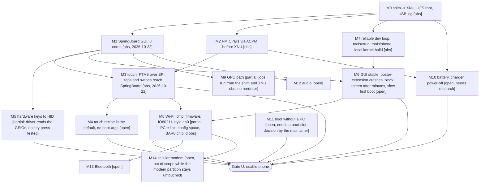

# Milestones: from "boots to GUI" to a usable device

Tags: **[obs]** observed on hardware, **[src]** read from source, **[guess]**, **[open]** not started.
An arrow `A --> B` means B needs A. Updated 2026-10-24. Per-driver detail and evidence: [Status](STATUS.md) and [Coverage](COVERAGE.md).

"Usable device" (Gate U) = touch, buttons, a stable GUI, Wi-Fi, battery/charging, and a boot without a PC.

## What comes next

1. **M8 Wi-Fi** (milestone 2): backplane core enumeration, firmware and NVRAM download from the shim, then a PCIe and Broadcom driver in the kernel and the `apple80211` front end.
2. **M9 GPU**: fix the kernel panic when a GPU buffer is mapped into a process, then a first GPU-rendered frame.
3. **M6 stability**: the poster-extension crash loops, the black screen after minutes and the 14+ minute first-boot migration.
4. **M11** needs a decision by the maintainer: today the phone boots only through `fastboot boot` from a PC, and the project rules never write `boot*` partitions except by explicit exception.

## Open questions (measure or reverse, do not guess)

- Fuel gauge and charger interfaces on the Pixel 6a (M10).
- Whether key presses reach HID (M5).
- How the Broadcom firmware behaves after download. The firmware and NVRAM files come from the user's own phone image and are never committed.
