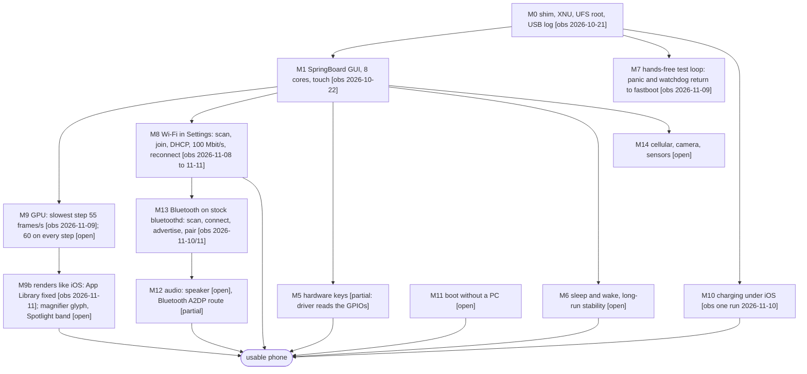

# Milestones

**Last verified: 2026-11-16.** How the port got from "our code runs" to an iPhone UI with GPU, Wi-Fi and Bluetooth, one milestone at a time.
Each milestone has its own page with the same headings: **the goal, what was done, how it was proven, what it unlocked, and the dead ends**.

## The milestones

| | Milestone | When | State | Proof in one line (*observed on hardware*) |
|---|---|---|---|---|
| M0 | [First boot: shim, XNU, root file system](milestones/first-boot.md) | 2026-10-20/21 | done | `launchd` runs from the `userdata` root |
| M1 | [SpringBoard: the iPhone UI](milestones/springboard.md) | 2026-10-22 | done | lock and home screen, 8 cores (run `usbnet4-cpus8`), touch |
| M7 | [Hands-free test loop](milestones/test-loop.md) | 2026-10-22 to 11-09 | done | a panic and a hang both return to fastboot (runs `20261107T145123Z-panic-self-recover`, `ar-c-wdttest`) |
| M9 | [GPU: 55 frames/s](milestones/gpu.md) | 2026-10-23 to 11-11 | done; 60 open | slowest navigation step 56.6 (run `gputest-nav43`) |
| M8 | [Wi-Fi in Settings](milestones/wifi.md) | 2026-10-21 to 11-11 | done | joined from Settings with a DHCP lease (runs `wlan-wui-f2`, `wlan-wui-g`) |
| M13 | [Bluetooth on the stock daemon](milestones/bluetooth.md) | 2026-11-03 to 11-11 | done | scan, connect, pair, bond after reboot (runs `bt-pr3`, `bt-hotpair`) |
| M10 | [Charging](milestones/charging.md) | 2026-11-10 | done, one run | battery current positive at 875 mA (run `chg-p3`) |
| | [Everything at once, at low clocks](milestones/all-on-low-clock.md) | 2026-11-11 to 11-15 | met, except drawn presents 49.0 of 50 | rendered 50.6 frames/s at 150 MHz with real internet, two boots (runs `155b`, `8177`) |
| M12, M5, M11, M6, M14 | [Open: audio, keys, boot without a PC, sleep, cellular and the rest](milestones/open.md) | | open | |

"Usable phone" = boots without a PC, a stable GUI at 60 frames/s, touch and buttons, Wi-Fi, Bluetooth, sound, charging. We are not there.

## How they depend on each other

Tags in the diagram: **[obs]** observed on hardware, **[open]** not started, **[partial]**.

## Measured ladder (generated)

The milestones above are the story. This table is the measurement: every rung with its newest number, date, run labels and evidence
tag. It is generated from the maintainers' run logs, so it cannot quietly fall behind them ([how](STATUS.md#sources)).

"Replaced" rungs are kept because their numbers are history: a bench that could not reach its target by construction was replaced
by a better one, and the page says so instead of deleting it. "One run" means a single hardware run that was not repeated.

<!-- progress:ladder:begin (generated by tools/render_progress.py from data/progress.json; do not edit) -->
Numbers as of **2026-11-15**, from the project's milestone ladder. "One run" means a single hardware run that has not been repeated.

| Rung | What is measured | State | Result | Evidence | Note |
|---|---|---|---|---|---|
| **Boot and UI** | | | | | |
| B-GUI | XNU boots from userdata to the iOS lock screen and home screen | **done** | lock and home screen on the panel (2026-10-22); today 19 of 19 captured screens match their references (lock, home pages, Settings, App Library) | observed on hardware, 2026-11-11, runs `about4`, `gputest-surffail-b` | first reached 2026-10-22; 8 CPU cores |
| B-TOUCH | Touch input reaches SpringBoard (FTM5 touch controller over SPI) | **done** | 85 touch-controller event lines with the GPU path up (2026-11-04); on 2026-11-15 a real finger on the demo boot: 5791 touch interrupts, 0 empty, 0 storm, interrupt mode | observed on hardware, 2026-11-15, runs `demo-gpu-touch-wifi`, `job 1308 (demo boot)` | first seen 2026-10-22; the 2026-11-15 row was driven by hand by the maintainer, unlock and app open done on their own recording |
| **GPU** | | | | | |
| G-F20 | Median distinct frames/s over the 240-swipe bench (target 20, stretch 30) | **done** | 38 (2026-11-04); the same bench from kernel trunk read 37 (2026-11-07) | observed on hardware, 2026-11-07, runs `gputest-cced-poll20`, `gputest-t2b87-trunk` | historical swipe bench, replaced by the navigation bench (G-NAV55) |
| G-F40 | Same, one swipe every 4 s (target 40, stretch 48) | target met, one run | 41 | observed on hardware, 2026-11-07, run `gputest-c21e-unmap` | historical swipe bench, not repeated: replaced by the navigation bench |
| G-F55 | Same, continuous swipe bench, panel presents/s (target 55) | replaced | sliding 10 s peak 52.9; this bench cannot reach 55 by construction (idle gaps between swipes) | observed on hardware, 2026-11-07, run `gputest-splitlag` | replaced by G-NAV55 (scripted navigation, frame-time witness) |
| G-10b-nav | Navigation score of the first navigation scorer (per-action busy fps p50, scripted session) | replaced | p50_min 18.0 on the first scored session | observed on hardware, 2026-11-07, run `gputest-nav2` | replaced by the frame-time witness of G-NAV55 |
| G-NAV55 | Slowest navigation step at or above 55 frames/s (frame-time bench v2.1: unlock, home pages, Settings, Spotlight, app launch; 2 boots) | **done** | slowest step 56.6 and 56.7 frames/s, pooled 59.8; repeated from the trunk build at 55.2 and 55.1 | observed on hardware, 2026-11-09, runs `gputest-nav43`, `gputest-nav44`, `gputest-trunk10`, `gputest-trunk11` | the last limiter was per-job completion polling; GPU interrupts lifted it |
| G-NAV60 | Every navigation step at 60 frames/s (the project goal) | partial | pooled 59.5 frames/s; slowest step Settings open 51.6 (it ranged 51 to 56 across boots) | observed on hardware, 2026-11-11, run `gputest-surffail-b` | pooled is near 60; the slowest step is not. Boost-clock config; the low-clock rows are G-LOW50 below |
| G-LOW50 | Low-clock bench: rendered frames at the GPU's lowest clock (150 MHz), bars 50 pooled / 45 slowest step; 600 s bench with full Wi-Fi load, 2 boots | **done** | rendered 50.6 and 50.6 pooled, slowest step 48.4 and 48.6 frames/s on two boots (bars met); 5 of 8 CPU cores, CPU A76 1663 / X1 1826 MHz static, GPU 150 MHz, memory 1352 MHz; 3.32 and 3.27 W, 33.4 to 39.8 C and 34.1 to 40.6 C | observed on hardware, 2026-11-15, runs `155b`, `8177` | more CPU does not help: A76 1836 gave rendered 50.5 (run fede) |
| G-DRAWN50 | Drawn presents that reach the panel at least 50 per second (same low-clock bench) | partial | 49.0 drawn presents/s with the pacing fix (one frame per vsync; about 47.5 before, estimated); all panel presents 49.9 and 49.5 without it, 51.2 with it. The 50/s bar is NOT met yet | observed on hardware, 2026-11-15, runs `18e1`, `155b`, `8177` | all panel presents 51.2/s with the fix; about 1.8/s of swaps are still lost when a third swap lands inside the hold |
| G-RENDER | The UI renders like iOS (captured frames match references, no black or missing layers) | partial | App Library blurred backdrop fixed (0 incomplete framebuffers, was 61 to 62 percent black); still open: magnifier glyph in the search field, a transparent-black band under the status bar in Spotlight | observed on hardware, 2026-11-11, runs `gputest-surffail-b`, `gputest-surffail-a` | surffail-a is the before (black), surffail-b the fix |
| **Wi-Fi** | | | | | |
| W-SCAN | Scan lists access points | **done** | 8 access points (first scan, 2026-11-03); all-channel scan 13 of 13 complete in about 4 s each, 35 networks in the first scan | observed on hardware, 2026-11-11, runs `20261103T223800Z-wlan-runG2-clm24b`, `wd6-rec1` |  |
| W-JOIN | WPA2-PSK join: 4-way handshake done, keys installed | **done** | M1 to M4 complete, pairwise and group keys set | observed on hardware, 2026-11-08, run `wlan-runG2-join25g` |  |
| W-PING | ICMP echo to the gateway from the kernel driver (10 of 10) | **done** | 10 of 10 echoes | observed on hardware, 2026-11-08, run `wlan-runG2-join26d` |  |
| W-IOSPING | ping from iOS userland over en0 | **done** | 10 of 10 echoes | observed on hardware, 2026-11-08, run `wlan-iosping-c` |  |
| W-UI | Network listed and joined in Settings > Wi-Fi | **done** | Settings shows the test network joined with a checkmark; en0 is the primary interface with a DHCP lease | observed on hardware, 2026-11-09, runs `wlan-wui-f2`, `wlan-wui-g` | two boots; the joined row still shows a Weak Security label |
| W-LIST | Settings > Wi-Fi lists nearby networks from a live scan | **done** | list of about 20 rows with lock and signal icons | observed on hardware, 2026-11-11, runs `wd6-scan2`, `wd6-scan3`, `wd6-rec1` |  |
| W-PERF | Throughput: every 1 s interval at least 100 Mbit/s down and 50 up for 30 s | **done** | down 112.4 and 110.2 Mbit/s, up 67.8 and 68.1, ping p50 under load 3 to 7.5 ms | observed on hardware, 2026-11-09, runs `wlan-perf-f2`, `wlan-perf-f3` |  |
| W-NET | Real internet from iOS: address, route, DNS and HTTPS checks pass (pixnet), under the full bench load | **done** | pixnet 9 of 9 checks on both bar boots, 0 link-down events; TCP download 285.4 and 188.1 Mbit/s average, upload 97.1 and 97.0 Mbit/s (host journal); UDP download lost 27.3 % and 39.5 % under the full bench load | observed on hardware, 2026-11-15, runs `155b`, `8177` | Rx buffer pool fix: no access-point deauth in two load boots (0357 boots, 173 to 230 Mbit/s full tests) |
| W-REL | Reliability: 3 cold boots with Wi-Fi up, reconnect after the access point drops the phone | **done** | 3 of 3 cold boots up; 4 of 4 outages over 2 boots: link down about 8 s after the ban, back up about 70 s later, ping 10 of 10 | observed on hardware, 2026-11-11, runs `wd6-cold1`, `wd6-cold2`, `wd6-cold3`, `wd6-apblock`, `wd6-apblock-r` |  |
| **Bluetooth** | | | | | |
| W-HCI | Controller answers HCI Reset over the UART | **done** | Command Complete read back (7 bytes) | observed on hardware, 2026-11-03, run `bt-s4h` | cause was the UART pads still set as GPIO |
| W-KC | iOS keychain writes succeed | **done** | 0 unsupported key-store calls | observed on hardware, 2026-11-03, run `kc-s1` |  |
| W-BTD | bluetoothd stays alive (60 s, 0 respawns) | **done** | alive at least 170 s, 0 respawns | observed on hardware, 2026-11-03, run `bt-s4k` | first done with a stopgap; superseded by W-BTUP on the stock daemon |
| W-BTUP | Stock bluetoothd, no binary patch, no defaults write: controller up, 0 daemon exits (2 boots) | **done** | stack powered in 53 to 75 ms, 0 daemon exits | observed on hardware, 2026-11-10, runs `bt-pr2`, `bt-pr3` | our kernel driver answers the vendor commands this iOS profile sends |
| W-BTSCAN | A scan lists nearby devices | **done** | CoreBluetooth discovered 52 and 64 devices | observed on hardware, 2026-11-10, runs `bt-pr3`, `bt-pr4` |  |
| W-BTCONN | iOS LE-connects to a scanned device | **done** | connect PASS, 1 GATT service read (2 boots), and again on the stock daemon | observed on hardware, 2026-11-10, runs `bt-conn1`, `bt-conn2`, `bt-pr3`, `bt-pr4` |  |
| W-BTADV | LE advertising | **done** (one run) | advertising set up, chip status 00, 90 s | observed on hardware, 2026-11-10, run `bt-pr4` | one run |
| W-BTPAIR | Pairing with a peer; the bond survives a reboot | **done** | PIN success, paired and bonded on both sides; after a reboot iOS reports bonded=1; a headset paired too (2026-11-11); on 2026-11-15 a headset was paired by hand in Settings: Simple Pairing Complete status 0, Link Key Notification, 3 connections complete | observed on hardware, 2026-11-15, runs `bt-hotpair`, `bt-a2dp`, `bt-va3`, `job 1308 (demo boot)` |  |
| W-BTDEF | Bluetooth up by default, no boot arguments, without delaying launchd | **done** (one run) | launchd starts 0.8 s after the firmware load begins (was about 42 s); stack powered, LE connect PASS | observed on hardware, 2026-11-11, run `bt-def1` | one run |
| **Audio** | | | | | |
| A-A2DP | Audio plays to a Bluetooth headset (A2DP) | partial | the headset pairs and iOS opens an A2DP stream (SBC 44.1 kHz) but never starts it: no audio route | observed on hardware, 2026-11-11, run `bt-va3` | cause not found yet |
| A-SPK | Audio from the phone's own speaker | open | none yet: no speaker or codec driver | not started | the iOS audio stack itself runs: a 60 s test tone plays to a virtual device (bt-va1) |
| **Power** | | | | | |
| P-CHG | The battery charges while iOS runs | **done** (one run) | battery current -40 mA before, +107 to +205 mA after raising the input limit to 875 mA on USB 3 | observed on hardware, 2026-11-10, run `chg-p3` | the bootloader leaves a 500 mA limit; one run, load under GPU boots not measured |
| **Tooling** | | | | | |
| P-RECOVER | A kernel panic returns the phone to fastboot with no hand on it | **done** | panic self-recover PASS (2026-11-07); a hardware watchdog also returns a hung phone (2026-11-09) | observed on hardware, 2026-11-09, runs `20261107T145123Z-panic-self-recover`, `ar-c-wdttest` |  |
<!-- progress:ladder:end -->

## What comes next

The open items, with what would prove each one: [Open milestones](milestones/open.md). The order the maintainers intend to take
them in: [Roadmap](../ROADMAP.md). To pick one up: [Contributing](../CONTRIBUTING.md).
