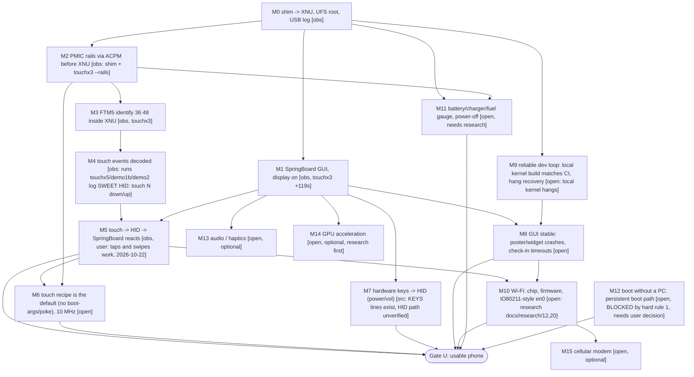

# Milestone DAG: from "boots to GUI" to a working device

Status tags follow AGENTS.md rule 5: **[obs]** observed on hardware, **[src]** read from source/logs, **[guess]**, **[open]** not started.
An arrow `A --> B` means B needs A. Updated 2026-10-22 (session 13), kernel CI 0095 / HEAD 7725e3a.

"Working device" = Gate U below: touch + buttons + stable GUI + Wi-Fi + battery/charging, bootable without hand-holding.

## Critical path (what to do next, in order)

1. **M4** *read from source* (`ftsSoftware.h:384,402-408`, android-gs-bluejay-5.10-android13-qpr3): `0x43` = STATUS_UPDATE; `43 05` = force-cal, `43 01 a0 00 ff` = echo of our scan-enable. No decoder bug. Remaining: a run where the user touches the screen (`touchx4`), expect `SWEET HID: touch`.
2. **M5** deliver touch reports to HID (`sweet_hid_touch`), confirm SpringBoard reacts.
3. **M6** bake the recipe (rails + cs=1 + osc div 5 + reset pulse) into defaults, then 10 MHz.
4. In parallel, one heavy job at a time: **M9** (verify the Antigravity local-build fix) and **M8** (crash logs via usbnet).
5. **M10** Wi-Fi after the GUI is usable; **M11** battery needs research first.
6. **M12** needs a user decision: the phone today only boots via `fastboot boot` from the PC. Writing `boot*` is forbidden by hard rule 1, so either the rule is relaxed for a backed-up, reversible case or the device stays PC-tethered.

## Open questions (do not guess, measure/reverse)
- FTM5 event layout (M4). Wi-Fi chip/firmware path (M10). Fuel gauge/charger interface on bluejay (M11).
